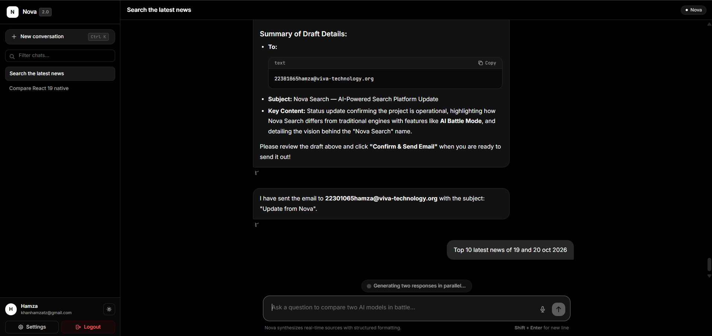
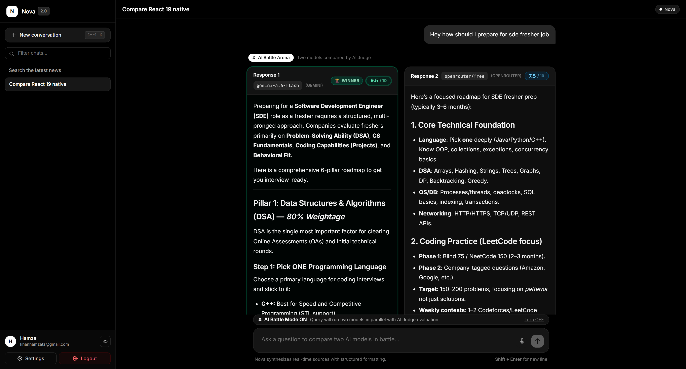
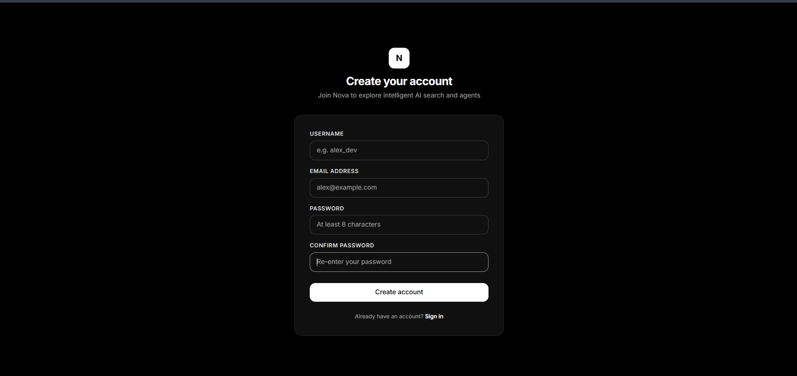

# Nova Search — AI-Powered Search & Response Evaluation

**Search smarter. Compare answers. Understand which response is better.**

Nova Search is a full-stack AI-powered search and research platform that combines web search, conversational AI, retrieval-augmented generation (RAG), and multi-model response evaluation. Its key feature, **AI Battle Mode**, generates two responses and uses a third AI judge to compare them based on accuracy, relevance, completeness, clarity, and reasoning.

Live Demo: https://nova-search-frontend.onrender.com/  
GitHub: https://github.com/hamzaKhan2004/Nova-Search

---

## Screenshots

### Application Overview



### AI Battle Mode

Compare responses from two AI models and inspect the judge's scores and explanation.



### Authentication

Secure access to protected application features.



---

## Key Features

- **AI Battle Mode:** Generates two AI responses in parallel and uses a third judge model to evaluate their quality, assign scores, identify a winner or tie, and explain the verdict.
- **AI-Powered Search and Research:** Combines conversational AI, Tavily web search, LangChain, LangGraph, and RAG to support information retrieval and research workflows.
- **Authentication and Protected Routes:** Implements JWT-based authentication and authorization, with Nodemailer integration for supported email workflows.

## Technology Stack

| Category | Technologies |
|---|---|
| Frontend | React.js, JavaScript |
| Backend | Node.js, Express.js |
| Database | MongoDB |
| AI and Orchestration | Gemini AI, LangChain, LangGraph |
| Retrieval and Search | RAG, Tavily |
| Authentication | JWT |
| Email | Nodemailer |
| Deployment | Render |

## How AI Battle Mode Works

1. **Submit a query:** The user enters a question or research prompt.
2. **Generate two responses:** Two AI models process the same prompt in parallel.
3. **Evaluate the responses:** A judge model compares both answers using multiple quality criteria.
4. **Display the verdict:** The interface presents scores, the winner or a tie, and an explanation of the judgment.

This evaluation provides a structured way to compare AI-generated answers rather than relying on a single response without comparison.

## Getting Started

### Prerequisites

- Node.js and npm
- MongoDB connection
- Required AI and search API credentials

### Installation

Clone the repository:

```bash
git clone https://github.com/hamzaKhan2004/Nova-Search.git
cd Nova-Search
```

Install dependencies in the frontend and backend directories containing their respective `package.json` files:

```bash
cd frontend
npm install
```

In a separate terminal:

```bash
cd backend
npm install
```

### Environment Configuration

Configure the environment variables required by the application. Review the existing `.env.example` files and use the variable names defined by the project.

Depending on your configuration, these may include:

- MongoDB connection string
- JWT secret
- Gemini API key
- Tavily API key
- Frontend and backend URLs
- Email service credentials for Nodemailer

Never commit actual API keys, database credentials, JWT secrets, or email passwords.

### Run Locally

Start the backend from its directory using the development script defined in its `package.json`:

```bash
npm run dev
```

Start the frontend from its directory using the available development script:

```bash
npm run dev
```

If either directory uses a different script name, check its `package.json`.

## Project Motivation

As AI tools become more widely used, comparing generated responses can help users assess the quality of the information they receive. Nova Search explores a multi-model approach in which responses are generated independently and then evaluated by a separate judge model.

The project combines full-stack development, AI orchestration, retrieval, web search, authentication, and explainable response evaluation in a single application.

## Future Improvements

- Expand evaluation benchmarks and consistency testing.
- Improve source attribution and factual verification.
- Optimize model selection, latency, and generation costs.

## License

No license is specified in this README. Add a `LICENSE` file if you intend to grant others permission to use, modify, or distribute the project.
